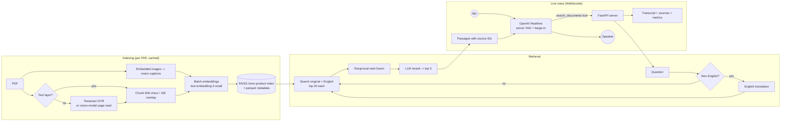

# Voice-to-Voice Multilingual RAG, with receipts

Talk to your PDFs out loud, in English, Telugu or Hindi, and hear the answer in the language you
asked in. Every answer is built to be traceable to a page of the source, and the repository ships
the evaluation harness and measured results that show how often that holds.

> **Status: working prototype with a small, honest evaluation.** The numbers below come from a
> 32-question development set I labeled myself over four scanned PDFs. They show what each change
> did on that set; they are not a validated benchmark. See [Limitations](#limitations).

## What it does

1. **Upload up to five PDFs** (text or scanned) in the browser. They are read (text layer, OCR, or
   image captions), chunked, embedded and indexed locally with FAISS.
2. **Click Connect once and just talk.** A single OpenAI Realtime session handles speech-in and
   speech-out with server-side voice-activity detection, so you can interrupt it mid-sentence.
3. **The assistant searches your documents through a tool call** before it answers. Retrieved pages
   appear next to the live transcript, with excerpts and page previews.
4. **Answer language follows the language you spoke.** It is decided from the script of the
   transcript, not from the voice model's guess.

Separately, a text pipeline (`grounded_answer.py`) answers with claim-level citations and a
fail-closed verifier. It is evaluated end to end in this repo but is **not yet wired into the live
voice path** (see [Roadmap](#roadmap)).

## Architecture



Key design points:

- **Server-side tools.** The browser never sees the API key; the server runs retrieval and sends
  results back to the Realtime session. A failing tool returns an error to the model instead of
  ending the call.
- **Two-stage retrieval.** Dense search over-fetches 20 candidates; an LLM reranker picks the final
  5 with strict output validation and a FAISS-order fallback on timeout (single 4 s deadline).
- **Cross-language bridge.** Dense retrievers favour same-language passages, so a Hindi question can
  miss the English page that answers it. Non-English queries are also translated to English, both
  rankings are searched and fused with reciprocal-rank fusion.
- **Language chosen by script.** The transcript arrives about 2 s after the model has already
  called its tool, so the server waits (bounded, overlapped with retrieval) for it and maps its
  writing system to a language. This replaced trusting the voice model's own guess, which once
  answered Telugu in Malayalam.
- **Receipts.** Retrieved passages carry source IDs and page numbers to the UI. A post-hoc citation
  auditor links answer spans to exact quotes. The text pipeline goes further (below).

### Grounded answer pipeline (text, evaluated)

`grounded_answer.py` turns retrieved passages into an answer that can be audited:

1. The model drafts an answer as **claims**, each with the passage ID and an exact **quote**.
2. **Quote check:** a claim survives only if its quote occurs in the cited passage (exact, or at
   least 90% character match to tolerate OCR hyphenation and typos).
3. **Support check (optional):** a second model call asks whether each quoted claim is actually
   *supported* by the passage. Quote presence alone proved insufficient: a fabricated "translated
   into English in 1804" claim carried a real quote from an unrelated passage.
4. The final answer is **rebuilt from verified claims only**. If none survive, the answer is a fixed
   "I couldn't find that in your documents" in the question's language (en/te/hi/bn).

## Results

All numbers are from the local development set in `benchmarks/` (32 questions, four scanned PDFs:
an English philosophy text, a Telugu textbook lesson, a Hindi science chapter and a Bengali poem
page). The PDFs are not in this repo (copyright); bring your own and relabel. Full tables, caveats
and reproduction commands are in [`benchmarks/RESULTS.md`](benchmarks/RESULTS.md).

### Retrieval (page-level)

"Reranked" is what the assistant actually sees. Hit@k means a labeled evidence page is among the
first k distinct pages.

| Configuration | Candidate recall | Hit@1 | Hit@3 | Hit@5 | MRR@5 | Time |
|---|---|---|---|---|---|---|
| Tesseract OCR, no query expansion (baseline) | 0.938 | 0.875 | 0.938 | 0.938 | 0.901 | 1.4 s |
| **Tesseract OCR + English query expansion (shipped)** | **1.000** | **0.906** | **0.969** | **0.969** | **0.932** | 1.7 s |
| Vision-model page reading, no expansion | 0.875 | 0.812 | 0.844 | 0.844 | 0.828 | 1.4 s |
| Vision-model page reading + expansion | 0.938 | 0.906 | 0.906 | 0.906 | 0.906 | 1.6 s |

- LLM reranking lifted Hit@1 from 0.625 (FAISS order) to 0.875 on the baseline.
- Query expansion fixed both Telugu and Hindi questions about the English text, which previously
  retrieved the Telugu and Hindi documents instead.
- Vision-model page reading is available (`--ocr vision`) but did not win overall: it fixed one
  Telugu question and lost two others.

### Answer-level grounding (24 answerable, 8 unanswerable questions)

A separate, stronger judge model (`gpt-5.5`) scores correctness against a reference answer and
checks every proposed claim against its full cited passage. **The judge is a model, not ground
truth, and is not yet calibrated against human labels.**

| Run | Abstained on unanswerable | False abstain | Correct | Shipped claims supported | Answer language correct |
|---|---|---|---|---|---|
| Quote check only | 7/8 | 2/24 | 21/24 | 30/32 | 100% |
| Quote + support check, run 1 | 8/8 | 3/24 | 19/24 | 27/28 | 100% |
| Quote + support check, run 2 (repeat) | 6/8 | 2/24 | 18/24 | 29/31 | 100% |

What I take from it:

- **Run-to-run noise is as large as the effect.** The same configuration abstained on 8/8 and 6/8
  unanswerable questions in two runs. I do not claim the support check improves abstention until the
  set is larger and runs are repeated.
- **Answer language went from 77% to 100%** once the target language was passed explicitly. Before,
  the model copied source-language quotes into its answer.
- **Grounding is only as good as the index.** An elephant life-span question (unanswerable; the
  figure leaves it blank) is answered with the crocodile's number because the image *caption* in the
  index misattributed the labels. The cited passage "supports" the claim; the index itself is wrong.
- **OCR noise causes false abstentions.** The model "corrects" typos (e.g. `7imaeus` to `Timaeus`)
  inside its quote, and Telugu OCR is often garbled.
- The support check adds about 0.7 s per answer.

### Not yet measured

Spoken input and output quality (word error rate, turn-detection errors, time to first audio on real
sessions), a speech-to-speech vs cascaded comparison, human calibration of the judge, repeated runs
with confidence intervals, and any public redistributable corpus.

## Quickstart

Requirements: Python 3.11+, an OpenAI API key with access to the models in
[`config.py`](config.py), a browser with microphone access (headphones recommended to avoid echo),
and Tesseract if you index scanned PDFs.

```bash
git clone https://github.com/Adarshgurazada/voice-to-voice-multilingual-rag.git
cd voice-to-voice-multilingual-rag
python3 -m venv .venv && source .venv/bin/activate
python -m pip install -r requirements-dev.txt     # app + tests

cp .env.example .env                              # then edit .env
```

`.env`:

```dotenv
OPENAI_API_KEY=your_key_here
# Tesseract language codes joined with "+" (not commas). Needed only for scanned PDFs.
OCR_LANGUAGES=eng+tel+hin+ben
```

Install Tesseract and its language data for scanned documents (macOS: `brew install tesseract
tesseract-lang`). The code finds Homebrew and common Linux `tessdata` folders automatically; set
`TESSDATA_PREFIX` otherwise. Missing language data raises an indexing error rather than silently
skipping a scanned page.

Run:

```bash
python live_app.py        # serves http://127.0.0.1:8000 (localhost only)
```

Open the page, choose PDFs, click **Index documents**, then **Connect** and speak. Indexing a new
PDF makes paid OpenAI calls (embeddings and image captions) and can take minutes; re-uploading the
same file reuses the local cache in `.local_data/`.

The server logs every turn: the user transcript, the language detected from its script, what the
voice model claimed, the language it answered in, and a warning on any mismatch.

## Running the evaluations

```bash
export OCR_LANGUAGES=eng+tel+hin+ben
PDFS="--pdf docs/plato.pdf --pdf docs/telugu.pdf --pdf docs/hindi.pdf --pdf docs/bengali.pdf"

# 1. Validate labels offline (no API calls)
python eval_rag.py --dataset benchmarks/dev_local.jsonl $PDFS --dry-run

# 2. Retrieval: FAISS vs reranked, per-language and per-category breakdowns
python eval_rag.py --dataset benchmarks/dev_local.jsonl $PDFS [--no-expand] [--ocr auto|vision|off]

# 3. Answer-level grounding, abstention, correctness, answer language
python eval_answers.py --dataset benchmarks/answers_dev_local.jsonl $PDFS [--no-support-check]

# 4. Spoken-turn metrics from labeled turns (word error rate, language accuracy, VAD errors, p50/p95)
python eval_voice.py --dataset path/to/labeled_voice_turns.jsonl
```

Reports are written to `.local_data/`. Index caches are fingerprinted by PDF hashes, models, chunking,
OCR mode and pipeline version, so a comparison is only valid between runs on identical inputs.

**Retrieval cases** (`benchmarks/dev_local.jsonl`): `id`, `query`, `expected_pages` (`doc`, `page`,
optional `quote`), optional `category` and `language`. Failures are labeled `candidate_miss` (FAISS
never found it), `not_promoted`, `rerank_drop`, `late_rank` or `top1_hit`.

**Answer cases** (`benchmarks/answers_dev_local.jsonl`): `id`, `query`, boolean `answerable`, and for
answerable cases a short `reference` and `expected_pages`. Unanswerable cases include near-misses (a
figure whose value is blank) and off-topic questions.

**Answer metrics:** abstention recall (unanswerable), false-abstain rate (answerable), correctness vs
reference, citation page hit rate, raw vs shipped claim support rate (judge, against the full
passage), unsupported shipped claims, answer-language match (by script), and latency.

## Configuration

| Setting | Where | Default |
|---|---|---|
| Realtime voice model | `config.py` `REALTIME_MODEL_ID` | `gpt-realtime-mini` |
| Embeddings | `EMBEDDING_MODEL_ID` | `text-embedding-3-small` (1536-dim) |
| Vision captions, rerank, quiz | `VISION_MODEL_ID`, `RERANK_MODEL_ID`, `QUIZ_MODEL_ID` | `gpt-5.4-mini` |
| Answer drafting and in-pipeline support check | `ANSWER_MODEL_ID`, `SUPPORT_MODEL_ID` | `gpt-5.4-mini` |
| Evaluation judge (independent of the pipeline) | `JUDGE_MODEL_ID` | `gpt-5.5` |
| Transcription | `TRANSCRIBE_MODEL_ID` | `gpt-4o-mini-transcribe` |
| Retrieval | `module_v2v_rag.py` | 20 candidates, top 5, 800-char chunks, 150 overlap |
| OCR languages | `OCR_LANGUAGES` env | `eng` |

## Project layout

```
live_app.py            FastAPI server: uploads, WebSocket voice loop, tools, turn logging
voice_session.py       Session state, Realtime tool schemas, language detection by script
module_v2v_rag.py      PDF reading (text/OCR/vision), chunking, batched embeddings, FAISS,
                       query expansion, reciprocal-rank fusion, LLM reranking
grounded_answer.py     Claim + quote answers, quote verifier, support check, abstention
citation_audit.py      Post-hoc claim-to-quote spans for the live transcript
eval_rag.py            Retrieval benchmark (FAISS vs reranked, ablation flags)
eval_answers.py        Answer-level grounding / abstention / correctness benchmark
eval_voice.py          Spoken-turn scoring (word error rate, language, VAD, latency)
study_quiz.py, study_mcp.py, glossary_mcp.py, study_glossary.json
                       Voice quiz, and a small local MCP glossary tool (see Limitations)
live_web/              Browser UI (AudioWorklet mic streaming, transcript, sources)
benchmarks/            Development datasets and RESULTS.md
tests/                 77 offline tests (no network or API key needed)
```

## Tests and CI

```bash
python -m pytest -q          # 77 tests, offline, runs without OPENAI_API_KEY
```

GitHub Actions runs the same suite on every push (`.github/workflows/ci.yml`).

## Limitations

- **The evaluation is small and self-labeled.** 32 questions, one labeler, single runs. One question
  is about 3 points of retrieval accuracy; many differences above are one or two questions.
- **The LLM judge is uncalibrated** and I have not yet compared it with human labels.
- **The live voice path is not yet protected by the verifier.** It relies on prompt instructions plus
  a post-hoc citation audit, so an unsupported sentence can be spoken before it is flagged.
- **Indexed text quality bounds answer quality.** Garbled Indic OCR and mislabeled image captions
  both produced wrong or missing answers in the evaluation.
- **Telugu, Hindi and Bengali coverage is thin** in the benchmark (a handful of pages each).
- **Voice quality is unmeasured on real sessions.** Short utterances can still be mis-transcribed,
  and if the transcript is late the voice model's own language guess is used as a fallback.
- **The quiz and glossary features are side experiments.** The glossary holds three entries and
  starts a subprocess per lookup, so it is a demonstration of the MCP wiring, not a real source.
- Sessions live in memory in one process and are never expired. This is a local single-user demo.

## Roadmap

1. Put the grounded-answer verifier in the voice path (speech-in, retrieve, verified text answer,
   speech-out) and measure the latency/faithfulness trade-off against the current speech-to-speech
   path on the same questions.
2. Calibrate the judge against human labels and repeat every run to report confidence intervals.
3. Hybrid keyword + dense retrieval and a combined Tesseract + vision index as measured ablations.
4. A public, redistributable multilingual corpus so the benchmark can live in the repo.
5. An answer panel with claim-to-quote highlights and a per-turn trace timeline.

## Data, privacy and copyright

Audio is streamed to OpenAI and is not saved by this app; OpenAI's API data policies still apply.
Uploaded PDFs, indexes and evaluation reports stay under `.local_data/` on your machine (git-ignored),
and `.env` is git-ignored. The source PDFs used for development are third-party material and are not
redistributed with this repository; evaluation labels in `benchmarks/` reference them by name only.
